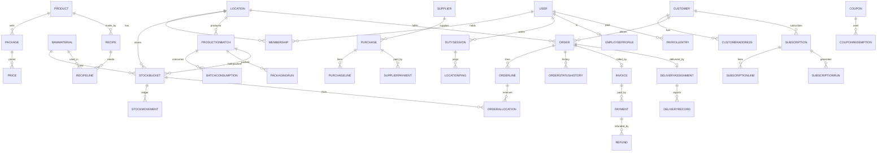

# Architecture

## Big picture
```
React PWA ──HTTPS──► Nginx ──► Django + DRF ──► PostgreSQL
 (staff app)                      │
                                  ├─► Redis ─► Celery worker/beat (subscriptions, alerts)
                                  └─► media files (product images)
```
- **One backend, one database.** Browsers, phones and any future native app all call the same `/api/v1/`.
- **All business rules live in Django `services.py` files** (stock, pricing, tax, payments). React only shows data and collects input. Money and stock are never calculated in the browser.
- Each business module is a Django app in `backend/apps/<name>/` with the same layout: `models.py` (tables), `services.py` (rules, inside database transactions), `serializers.py`, `views.py` (permissions + HTTP), `urls.py`.

## Multi-location, not multi-tenant
Zeal is **one business with several sites**, so there is one schema and operational tables carry a `location` foreign key.
Multi-tenancy (separate data per company) would make cross-location reports, transfers and the owner's consolidated view
hard or impossible. Access is enforced with memberships: a user holds a *role at a location*. `Location Admin` in Sivakasi
sees nothing of another site. The Super Admin sees all.

## Roles and permissions (RBAC)
`apps/accounts/rbac.py` maps roles to permission codes (`inventory.adjust`, `payments.record`, `reports.view` ...).
Every ViewSet declares `perm_read` / `perm_write` / `action_perms` and a `location_field`; `RBACViewSetMixin` then
(1) rejects users without the permission, (2) filters querysets to locations where the user holds that permission,
(3) checks the location of anything created. The React app hides menu items using the same permission list, but that is only convenience.

| Authentication | Authorization |
|---|---|
| "Who are you?" Session cookie after login | "What may you do?" Permission at a location |
| `accounts/views.py` | `accounts/rbac.py`, `accounts/api.py` |

## The inventory ledger (the heart of the system)
`StockBucket` = current balance of one item at one location (and batch). `StockMovement` = append-only history.
Only `inventory/services.py` changes a bucket, and it always writes the movement in the same transaction:

```
purchase +raw ─► production: raw −, bulk +  ─► packaging: bulk −, packed + ─► order reserve ─► dispatch: packed − (sale)
                                                  transfer: −source / +destination        return: + (optional)
```
- Rows are locked (`select_for_update`) so two people cannot sell the same last packets. There is a concurrency test for this.
- Database `CHECK` constraints stop negative stock and `reserved > quantity` even if code were wrong.
- Packets are allocated **FIFO by expiry** and expired batches are never sold.
- Movement types: purchase, production, consumption, packaging, sale, return, transfer_out, transfer_in, adjustment, wastage, expiry, damage.

## Order lifecycle
`pending → confirmed → dispatched → completed`, with `cancelled` possible before dispatch.
Create snapshots price, discount and GST on each line. Confirm reserves stock. Dispatch turns reservations into sale
movements and issues the invoice. After dispatch use **returns** (credit on the invoice) not cancellation.

## Money rules
- `Decimal` everywhere, rounded half-up to 2 places (`core/money.py`).
- Cash example: bill ₹250, customer gives ₹500 → `Payment.amount=250`, `tender_amount=500`, `change_returned=250`. Cash expected at closing counts only ₹250.
- Payments, refunds, ledger rows, audit rows and delivery records are **append-only** at model level (`AppendOnlyModel`): editing or deleting raises an error.
  Corrections are new rows that point to the old one, plus an audit entry with the reason.
- Dashboard numbers come from invoices, payments, the ledger and batches, never from stored totals.

## Units (litre / kg)
`Unit` rows carry a factor to a base (ml, g, piece). Each product chooses its **base unit** (litre or kg); packages choose their own unit.
Converting between litres and kg is refused unless the product has a **density** set (`catalog/models.py: convert`).

## Delivery charges
`delivery/fees.py: quote()` works out the fee for every order: distance (straight line from the unit's pin to the address pin x road factor)
picks a **slab** (`base fee + per-km x km beyond the slab start`); a **busy-day rule** adds a percent or flat surcharge once the day has N orders at that location;
orders above the **free-delivery** amount pay nothing; addresses with no pin use the default fee; beyond the max distance the order is refused.
The result and its breakdown are stored on the order (`delivery_fee_detail`), so old orders never change when you edit the rules. The fee is always computed by the server; the browser only previews it.

## Attendance and payroll
Staff check in/out once a day (`/attendance-check/`). A day with at least `full_day_hours` counts 1, at least `half_day_hours` counts 0.5.
Monthly pay = salary / working days x credited days (capped); hourly pay = rate x hours. Days with no check-out earn nothing until an admin corrects them (audited, reason required).
Payroll preview shows net pay (pay + bonus - advances - deductions); Generate creates one auto salary entry per employee per month (a database constraint prevents duplicates; void to regenerate).

## Subscriptions
Daily job creates one order per due subscription. `SubscriptionRun(subscription, date)` has a unique constraint, so running the job twice
never duplicates orders. Holidays are skipped, paused/cancelled are ignored, failures (e.g. inactive customer) are recorded on the run.

## GPS tracking
Employees start a *duty session* and must consent; pings are accepted only during an open consented session; managers can view only
employees who work at their locations; `python manage.py purge_old_pings --days 30` enforces retention.
**A PWA cannot track reliably in the background (especially iPhone).** Tracking works while the app is open. If you need reliable
background tracking later, build a thin native (React Native/Flutter) delivery app against the same `/delivery/duty/` endpoint.

## Database design (ER overview)
UUID primary keys on every business table (not guessable, safe to generate offline). Foreign keys use `PROTECT` for anything financial or
stock related so history cannot be orphaned.



Key constraints: `unique(location, key)` on stock buckets; `quantity ≥ 0`, `reserved ≤ quantity`; `unique(subscription, scheduled_date)`;
`unique(order, reason)` for loyalty awards; `OneToOne(coupon redemption → order)`; invoice number unique; one cash closing per location per day.
Run `python manage.py sqlmigrate <app> 0001` to see the exact SQL, and read each `apps/<app>/models.py` for fields and types.

## Backend folder map
```
backend/
  config/            settings, urls, celery
  apps/core/         base models, audit log, settings, number sequences, money/tax helpers, seed command
  apps/accounts/     users, memberships, RBAC, login
  apps/locations/ catalog/ inventory/ purchasing/ production/ customers/ promotions/
  apps/orders/ billing/ delivery/ hr/ finance/ subscriptions/ notifications/ dashboard/
  tests/             business-rule and permission tests
```
## Frontend folder map
```
frontend/src/
  theme/        theme.css (all brand colours), applyTheme.ts
  i18n/         index.ts + locales/{en,ta}/<namespace>.json
  lib/          api.ts (axios + CSRF), format.ts (₹, dates, numbers)
  auth/         AuthContext (login, permissions, language)
  components/   ResourcePage (generic list/create/actions), ui, layout, LanguageSwitch
  pages/        resources.tsx (screen definitions), Dashboard, DeliveryPage, Settings, Login
```
